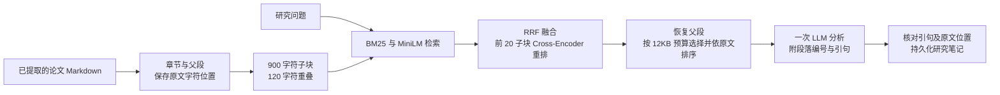

# 篇内证据检索与引用回查实测

## 本轮交付

在现有 Paper Agent 中增加可切换的篇内证据模式，完成公开项目学习、实现、公开数据留出评估、真实模型配对、正常研究笔记入口和桌面回归。

实际收益为减少模型输入用量，并为回答提供可定位的原文证据。本轮真实问答耗时增加，答案 F1 的差异尚不足以确认准确率提升。作为课堂展示，可将其定位为“有预算约束和来源追踪的论文 RAG”。

桌面入口为“设置 → 研究对照 → 对照配置 → 篇内证据检索”。对应 profile 为 `evidence`，只切换单篇分析策略。可切回 `baseline` 做单项对照。已有 `enhanced` 档位的定义继续以旧对照指南为准。

## 学习来源与移植内容

| 一手项目 | 采用的机制 | 本项目实现 |
|---|---|---|
| PaperQA2 | 按问题寻找证据，再组织生成上下文 | 在论文内部进行本地证据检索，保留原文及来源 |
| LlamaIndex | 子块检索后恢复父级上下文 | 小段用于评分，生成时恢复完整父段，按原文顺序排列 |
| Sentence Transformers | Bi-Encoder 召回与 Cross-Encoder 重排 | 复用已安装的 MiniLM 与 MS MARCO 模型 |
| QASPER | 人工问题、答案及支持证据 | 用官方 dev/test 数据做无标注泄漏的留出检验 |

实现根据上述机制编写，沿用本项目的 MCP、数据模型和预算约束，每篇仍采用一次生成调用。LlamaIndex 的多级递归合并与邻句窗口仅作为研究参考，当前实现恢复段落父块。

一手来源见 [PaperQA2](https://github.com/Future-House/paper-qa)、[PaperQA2 证据代码](https://raw.githubusercontent.com/Future-House/paper-qa/main/src/paperqa/docs.py)、[LlamaIndex 父块恢复](https://raw.githubusercontent.com/run-llama/llama_index/main/llama-index-core/llama_index/core/retrievers/auto_merging_retriever.py)、[Sentence Transformers 重排说明](https://www.sbert.net/examples/sentence_transformer/applications/retrieve_rerank/README.html)、[QASPER 原论文](https://aclanthology.org/2021.naacl-main.365/)。

## 技术路线



固定参数为子块 900 字符、重叠 120 字符、RRF 常数 60、重排前 20 子块、上下文上限 12,000 UTF-8 字节。字符与 UTF-8 字节是两个不同单位，预算包含段落标签和分隔符，发送前还检查完整 JSON 提示词的保守输入大小。

字节预算不足时优先选择完整父段。超长父段只能提供明确标记的原文窗口。所有选段记录原始字符起止位置和文本哈希。模型输出引用的编号必须存在，引句必须逐字出现在对应段落。正文使用了真实选段编号但遗漏独立引句时，由系统复制该原文段落补齐回查材料。未知编号与伪造引句仍会拒收。

范围为 `partial_fulltext`，审计记录原输入来源范围、实际检索方法、回退、截断和校验引用数。文字与位置核对只能证明引句来自原文，陈述是否被引句支持仍需阅读判断。输出正文附带引用编号与原文。

英文问题直接用于检索。中文任务复用已有查询规划提供的英文检索词，原始中文问题继续交给报告模型。英文关键词可能丢失细节，本轮量化结果只覆盖具体英文研究问题。

## 冻结的公开证据评估

使用官方 QASPER v0.3，按论文隔离开发集 20 篇、留出集 100 篇，每篇取一个问题。采用 SHA256 排序确定样本，筛选至少 24KB、可回答且人工证据能在所给文本中找到的论文。两个集合论文交集为零，检索器只读取问题和文本，gold 只进入事后评分。

开发集后冻结方法，再一次运行留出集。方法 SHA256 为 `e3375616bf5a396edd55e3c1004e747e45ee82460cc0c8e5c16583fb0779719c`。后续修复仅涉及模型输出引用处理，检索模块未调整。

| 方法 | 人工证据段覆盖率 | 完整证据集命中率 |
|---|---:|---:|
| 全文输入上界 | 100.00% | 100% |
| 前 12KB 截取 | 39.33% | 37% |
| BM25 选择父段 | 76.26% | 70% |
| 纯向量选择父段 | 78.55% | 69% |
| 混合召回与联合重排 | 82.58% | 75% |

所有预算方法均满足 12KB 上限。新方法平均保留 38.54% 全文字节，即减少 61.46%。相对 BM25 覆盖率增加 6.32 个百分点，配对 bootstrap 95% CI 为 +0.69 至 +12.34 个百分点，15 题改善、5 题退化。相对纯向量检索的 +4.03 个百分点区间跨零，尚不能确认稳定优势。

这里统计归一化空白后的完整人工证据段覆盖，多参考取最佳匹配。它不是答案准确率。全部 500 条测量无模型回退，8,327 个子块有 50 个发生向量模型截断，查询与 Cross-Encoder 子块截断均为零。

离线五种方法顺序运行并共享向量缓存，其计时只用于诊断，不能用混合方法的缓存后时间宣称独立提速。

原始记录见 [留出结果](../data/validation/evidence-context-20261107/test-frozen/result.json)、[独立统计与置信区间](../data/validation/evidence-context-20261107/test-frozen/analysis.json)、[输入与来源清单](../data/validation/evidence-context-20261107/test-frozen/manifest.json)。

## 真实模型配对

固定取留出清单中按 question_id 排序的前 12 个合格问题，每题两轮交替路线顺序，共 48 次真实请求。两种方法使用相同英文答题提示词、DeepSeek Flash、thinking 关闭、temperature 0、最大输出 512 token。全文基线提交完整论文，证据路线提交所选原文。计时包括本地检索与 LLM。

| 指标 | 全文基线 | 证据路线 |
|---|---:|---:|
| 成功请求 | 24/24 | 24/24 |
| 输入 tokens 总数 | 174,332 | 64,796 |
| 总 tokens | 175,302 | 65,762 |
| 平均 Answer F1 | 0.5803 | 0.5942 |
| 全部配对总耗时中位秒 | 1.035 | 2.445 |
| 首轮新文档总耗时中位秒 | 1.070 | 3.826 |
| 第二轮缓存后总耗时中位秒 | 1.030 | 1.420 |

输入 tokens 减少 62.83%，总 tokens 减少 62.49%。按问题先聚合两次重复后，F1 差值为 +0.01385，95% bootstrap CI 约为 [-0.0072, +0.0381]。该结果支持明显减少输入用量，尚不足以证明回答更准确或统计等价。

F1 采用 QASPER/SQuAD 的归一化词重叠计分。人工复查发现正确的 Yes 加解释会被长度惩罚，部分答案分数上涨来自措辞缩短，另有一题确实遗漏了数据集名称。应把 F1 与实际原回答一起展示。新文档首轮全部 12 题更慢，缓存后仅 2 题更快，本轮没有获得端到端加速。

原始回答、上下文、用量和错误均保留在 [真实配对结果](../data/validation/evidence-context-20261107/answers-live-v1/result.json)。样本量为 12 个独立问题，两次重复不能算作 24 个独立样本。

## 正常入口修复与验证

另选前两篇，分别通过正式 `summarize_paper` 入口生成中文研究笔记。首次四次生成中，一份证据笔记因正文真实编号未在引用数组中重复列出而被拒收。一次诊断请求复现了同类情况，原始输出、失败与预算保留。修复为从已选原文段落补齐引用材料，并增加未知编号、伪造引句和合法编号遗漏的回归。

修复后的四次正常入口复测全部成功。两篇证据笔记分别有 2 条和 10 条引用，12 条均通过原文与字符位置核对，并明确标记部分全文。完整响应与报告见 [正常入口复测](../data/validation/evidence-context-20261107/production-recheck-v1/result.json)。此项验证调用和输出机制，不能替代大规模中文报告事实质量评估。

本轮累计 57 次真实请求，供应商报告输入 284,444 tokens、输出 12,269 tokens，合计 296,713 tokens。三个账本共预留 1,380,314 保守单位，处于本轮 60 次、200 万保守单位上限内。保守单位按输入 UTF-8 字节加输出容量估算，与计费 tokens 分开记录。

真实 MCP SDK 的集成测试覆盖该策略、范围、引用偏移、配置转发、持久化和重复调用幂等。桌面 E2E 验证档位保存与切换。模型用于验证公开论文，密钥由隐藏输入临时提供，未保存到配置或产物。

## 复现实验与课堂演示

先在命令提示符进入项目，下面的离线命令不会调用付费模型。

```bat
cd /d D:\学习资料\硕士\人工智能原理与应用\localwork\assignment-v1
.venv-v2\Scripts\python.exe -X utf8 scripts\evaluate_evidence_context.py --split test --limit 100 --output data\validation\evidence-context-recheck --frozen-method-sha e3375616bf5a396edd55e3c1004e747e45ee82460cc0c8e5c16583fb0779719c
```

真实配对脚本默认 dry-run，显式 `--live --yes --prompt-key` 才发请求。必须使用新输出目录，脚本拒绝覆盖历史账本。参数与用量定义见脚本帮助，默认硬上限 60 次、200 万保守单位。

课堂可按“问题 → 子块检索与父段恢复 → 引用回查 → 固定预算对照 → 实际生成代价”讲解。先展示一个具体问题的研究笔记及引用，再展示上面两张表。现有 Cross-Encoder 论文候选排序与这次篇内证据检索是不同阶段，可以分别切换演示。

## 主要变更与回归

- `agents/evidence_context.py` 提供可消融的 BM25、向量和混合证据选择。
- `agents/research_agent.py` 集成选段、来源范围、引用核对、回查附录和失败回退。
- `config.py`、`shared/contracts.ts`、`services/pipeline.py` 和桌面设置/性能页提供命名档位与真实策略显示。
- 两个评估脚本提供冻结的公开证据评估、真实模型配对与正常入口复测。
- 新增针对预算、原文偏移、模型回退、引用非法/遗漏、指标计算和 MCP 调用路径的测试。

完整 Python 回归在初次集成后为 483 passed、3 skipped。后续针对引用修复及新 MCP 路径的相关回归为 45 passed。TypeScript typecheck、桌面 build 通过，Electron 17 passed、1 skipped（未构建安装包），桌面 E2E 23 组通过。所有运行命令和原始结果均可回查。
